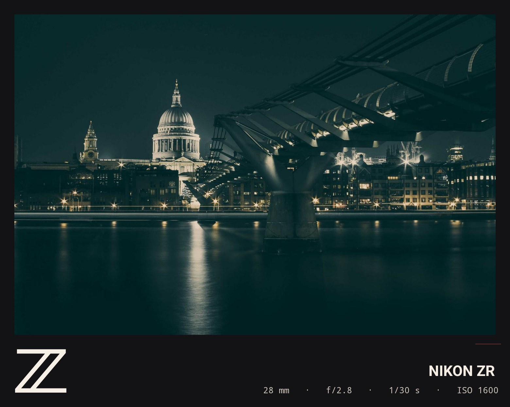

# KaiPrint · 光印


光印是 Android 摄影水印工作台。可在同一张照片上叠加署名、Logo、相机参数和边框，保存排版后批量导出。照片读取、渲染和预设管理均在设备上完成。成片独立保存到 `Pictures/光印`。

## 水印成片

| 画廊白框 | ZR 电影卡 |
| --- | --- |
|  |  |
| 米白边框，底部并排放置品牌标志和拍摄参数。 | 黑色底边，机型和拍摄参数分两行显示。 |

| 杂志侧栏 | 品牌角标 |
| --- | --- |
|  |  |
| 右栏显示品牌、机型、镜头和拍摄参数。 | 品牌标志和拍摄参数直接叠加在照片内。 |

以上 JPEG 由光印导出。水印中的机型、镜头和曝光参数用于排版演示。

<details>
<summary>原图来源</summary>

- 山谷照片由 Andrew Ridley 拍摄。[Wikimedia Commons 收录的 Unsplash 原图](https://commons.wikimedia.org/wiki/File:Quiraing,_Portree,_United_Kingdom_%28Unsplash_Kt5hRENuotI%29.jpg)
- 伦敦夜景由 Vadim Sherbakov 拍摄。[Unsplash 原图](https://unsplash.com/photos/a-view-of-st-pauls-cathedral-and-the-millennium-bridge-in-london-xS_RzdD5CFE)
- 建筑照片由 Anthony DELANOIX 拍摄。[Unsplash 原图](https://unsplash.com/photos/worms-eye-view-of-buildings-b5POxb2aL9o)
- 宠物照片由 Matthew Wiebe 拍摄。[Unsplash 原图](https://unsplash.com/photos/fawn-pug-covered-by-burberry-textile-between-plants-U5rMrSI7Pn4)

山谷照片采用 CC0，其余三张按 Unsplash 许可使用。[CC0](https://creativecommons.org/publicdomain/zero/1.0/) · [Unsplash 许可](https://unsplash.com/license)

</details>

## 安装和运行

Android 安装包、校验文件和版本说明见 [GitHub Releases](https://github.com/zhizhiheng/kaiprint/releases/latest)。[App 封面](docs/brand/app-cover.webp) · [品牌图制作说明和提示词](docs/brand/README.md)

使用 Android Studio 打开项目。命令行构建需要 JDK 17 或 21、Android SDK 36、NDK 28.2.13676358 和 CMake 3.22.1。项目通过 Gradle Wrapper 固定 Gradle 版本。首次构建需要下载 Android 依赖和带校验值的原生库源码。

```bash
./gradlew :app:assembleLibraryDebug
```

- `library` 支持经授权的设备相册、系统选图和文件夹导入。调试安装包在 `app/build/outputs/apk/library/debug/`。
- `picker` 通过系统选图、文件和文件夹导入。执行 `./gradlew :app:assemblePickerDebug :app:bundlePickerRelease` 可生成调试安装包和待签名的商店构建包。
- 支持 Android 10 及以上的 ARM64 和 x86_64 设备。

## 给照片加水印

1. 从相册、文件或文件夹选择照片。浏览设备相册时，点按编辑单张，长按进入多选。也可以在系统相册或其他应用里选中照片，点「分享」或「打开方式」，再选「用光印加水印」。
2. 在模板里选排版。在「发布到」一键把画布改成小红书 3:4、抖音 9:16、B 站封面 16:9 或方图 1:1，切换模板时比例保持不变。画廊白框、黑底参数条、杂志侧栏、ZR 电影卡和品牌角标会根据 EXIF 自动匹配内置矢量标志。批量处理时每张照片独立识别。
3. 打开「标注」选择品牌标志的样式和颜色。可保留 EXIF 自动识别，选择横版字标、方形或该品牌可用的图标。可以逐项选择机型、镜头、焦距、光圈、快门、ISO、拍摄时间、曝光补偿和等效焦距，缺失的值可逐张补填。边框和图层面板可调整留白、比例、位置及文字。也可以导入自定义 PNG、SVG、TTF 和 OTF。
4. 保存为预设后，可在预设页从菜单导出 ZIP。预设包包含排版和用到的 Logo、字体。
5. 导出当前照片或整组照片。成片尺寸可按长边或短边限制，例如大图按短边 1080 px 导出为 3:4 时，成片为 1080 × 1440。导出设置会记住上次的选择。任务中断后，从导出记录继续。导出完成后可从通知分享成片。超过 150 张时，点「分组分享」选择要发送的范围。

原尺寸模式保留校正方向后的照片像素尺寸，外扩边框会增大成片画布。文字和标志按照片短边缩放，同一台相机的横图和竖图字号一致。批量导出不设张数上限。JPEG、PNG、WebP 可选择 sRGB 或 Display P3。TIFF 输出为 8 位，含输出色域的 ICC 配置。导出默认保留常用 EXIF，移除定位和机身序列号。TIFF 可保留品牌、机型和拍摄时间。

### 胶片和手动镜头的参数组

胶片扫描件、转接的手动镜头没有拍摄参数。在「标注 → 改写水印参数」填好机型、镜头和 ISO，可点「应用到全部」写入整组，其余各项保持每张照片自己的参数。点「保存这张的改写」存成参数组，下次在「参数组」里一键套用到当前照片或整组。

### 毛玻璃、照片色卡和署名

- 「雾面展框」用烟灰色轻染外框，「雾面纪行」用偏冷的浅色。两款都从照片生成散焦外框和细颗粒。可在「边框」调节模糊和底色强度，在「图层」开启或关闭「随雾面明暗换色」。
- 「色谱图鉴」把照片主色排成色带。「图层 → 添加图层 → 照片色卡」也能给其他模板添加色带或分隔色块。
- 「极简片注」将参数放在照片内。「双栏档案」把镜头、参数和拍摄时间分开排版。
- 在「标注 → 标题、署名和地点」填写共用内容，随模板保存。可在「改写水印参数」单独改某张照片。地点为手填字段，留空时跳过。

这些模板使用光印已有的品牌识别规则和 Logo 样式，同一套排版可以用于不同厂商拍摄的照片。

在「标注 → 标志位置」可将厂标放在顶边或底边的左、中、右，也可放进照片四角或中心。边框空间不足时会自动增加留白。尼康照片在「标志样式」中选择「尼康黄底方标」即可。更细的位置调整在「图层」中完成。[尼康方标位置示例](docs/examples/nikon-logo-positions.jpg)

横幅山谷和竖幅瀑布分别用同一张照片在新旧版本中导出，可放大查看边框亮部和文字。山谷由 Andrew Ridley 拍摄，瀑布由 Paul Jarvis 拍摄，参数为排版演示值。[雾面成片对比](docs/examples/frost-comparison.jpg) · [瀑布原图](https://unsplash.com/photos/NYDo21ssGao)

## 构建验证

```bash
./gradlew :app:testLibraryDebugUnitTest :app:lintLibraryDebug :app:connectedLibraryDebugAndroidTest
```

拍摄格式、验证范围及样片来源见 [格式兼容与验证](docs/compatibility.md)。原生依赖许可和来源见 [第三方组件](docs/dependencies.md)。

## 开源与素材

KaiPrint 自有代码使用 [MIT 许可证](LICENSE)。品牌标志用于标注照片拍摄设备。项目记录了各标志的来源，品牌和商标权利归各自持有人。[品牌标志来源](docs/brand-marks.md)

可按机型下载 Nikon ZR、Sony α7 V 等独立型号标志，在编辑器的「图层」中添加为自定义 Logo。[机型标志素材库](model-marks/)
