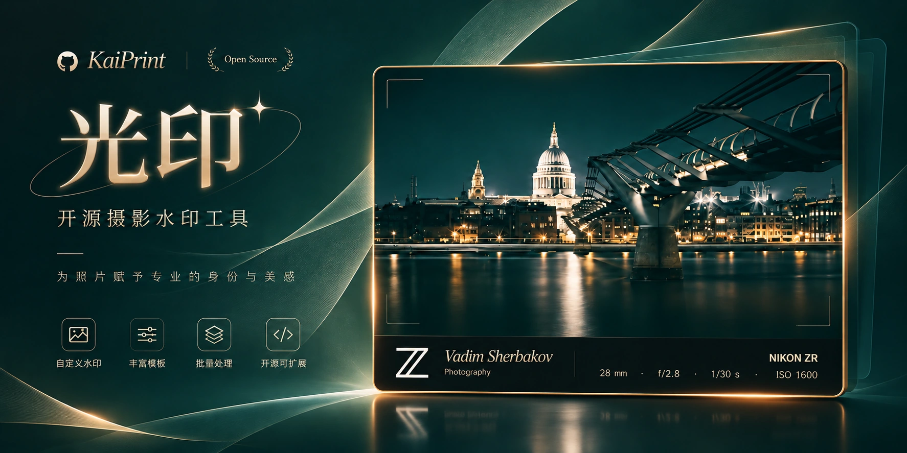
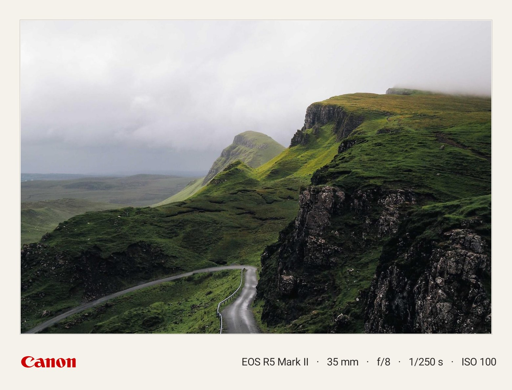
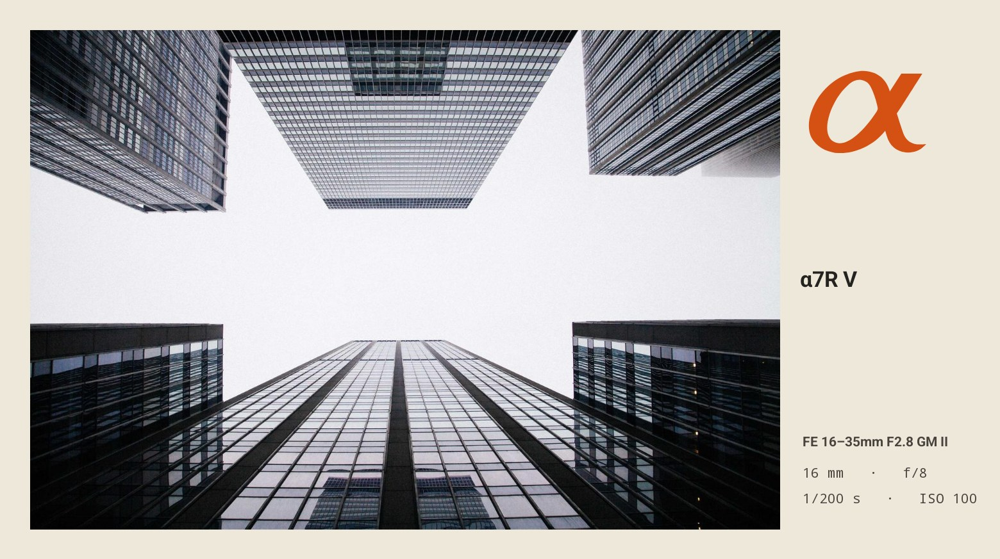
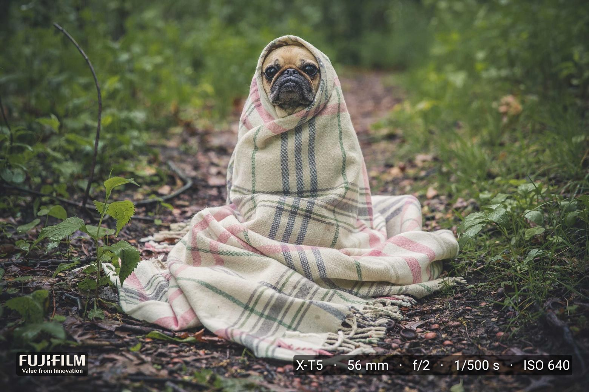
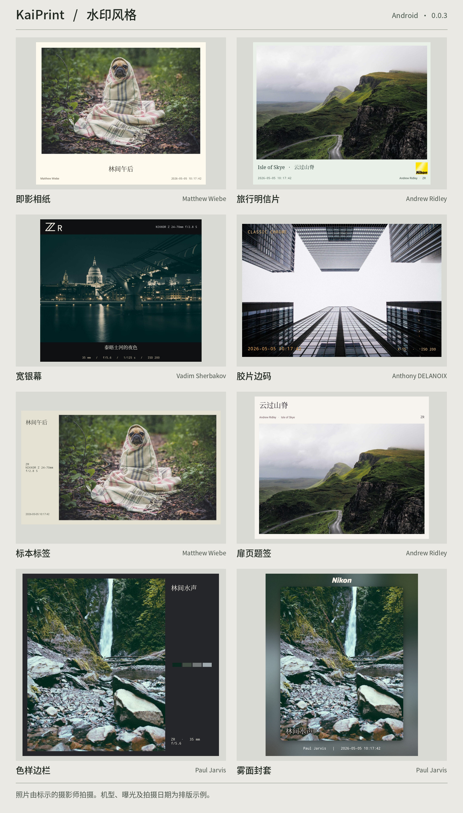

# KaiPrint · 光印



光印提供 Android 摄影水印工作台和可供 agent 调用的命令行工具。可在同一张照片上叠加署名、Logo、相机参数和边框，保存排版后批量导出。照片读取、渲染和预设管理均在设备上完成。Android 成片独立保存到 `Pictures/光印`。

当前正式版为 **0.0.3**，`main` 上的后续开发使用 **0.0.4**。发布页提供签名 Android 安装包、离线 Web 工作台，以及 CLI、MCP 和 skill。[0.0.3 正式版](https://github.com/zhizhiheng/kaiprint/releases/tag/v0.0.3)

## 0.0.3的个人库和桌面导入

CLI 与 MCP 共用用户目录下的 `.kaiprint/`。通用排版归入 `templates/`，含原照的作品归入 `projects/`。命令 `kaiprint config show` 会列出当前配置与路径。Web 支持通过系统对话框选择同一个库目录。[个人库、备份和迁移](docs/user-storage.md) · [MCP 工具与配置](docs/agents.md)

桌面可以打开 Photoshop PSD、Krita KRA、OpenRaster ORA 与 TIFF。设计工程使用保存的整幅合成图做底图，光印水印仍可逐层编辑。Android 可以只选这次要处理的照片；读取相册、照片地点和显示导出通知各有独立入口。[桌面样片格式与限制](docs/desktop-import.md) · [Android 权限与拒绝后的用法](docs/android-permissions.md)

## 照片与模板一起编辑（0.0.3）

在 Android 编辑器或 Web 工作台保存 `.kaiphoto` 时，可选两种内容。**仅模板**保存排版、可编辑图层、字体和 Logo，适合发给别人套在自己的照片上。**照片与模板**还保存当前原始照片和逐张手填信息。接收方可以重新打开作品，改署名、挪动标志，再导出成片。发送含原片的作品会一并发送其已有 EXIF，可能包含 GPS。

作品包支持 JPEG、PNG、WebP 和尼康 NEF，单张原照最大 256 MiB。可下载「斯凯岛明信片」试用，里面包含 Andrew Ridley 的风景照片和四层可编辑排版。[打开 v2 示例作品](examples/projects/skye-postcard.kaiphoto?raw=true) · [文件结构与兼容说明](docs/preset-format.md) · [照片来源与 CC0 标注](https://commons.wikimedia.org/wiki/File:Quiraing,_Portree,_United_Kingdom_%28Unsplash_Kt5hRENuotI%29.jpg)

### 启动本地 Web 工作台

在仓库根目录执行下列命令，然后在浏览器打开终端显示的地址（默认 `http://127.0.0.1:4173`）。选照片、读 EXIF、处理作品包和导出成片都在浏览器本地完成。

```sh
npm ci
npm run web
```

需要可离线分发的网页时，执行 `npm run web:build`。产物为 `build/kaiprint-web-studio.zip`，也可以直接从构建目录 `web/build/` 启动静态服务器。[离线使用与素材来源](web/README.md)

[Web 工作台实测截图](docs/examples/studio/web-editor.webp) · [Android 编辑器实测截图](docs/examples/studio/android-editor.webp) · [Android 保存作品面板](docs/examples/studio/android-save.webp)

设计稿位于独立 Figma 文件，包含 Web 和 Android 的创作与保存流程。[Web 编辑器](https://www.figma.com/design/1vu6uN2lTclFdof4f42U5N?node-id=1-4) · [Web 保存作品](https://www.figma.com/design/1vu6uN2lTclFdof4f42U5N?node-id=1-5) · [Android 编辑器](https://www.figma.com/design/1vu6uN2lTclFdof4f42U5N?node-id=1-6) · [Android 保存作品](https://www.figma.com/design/1vu6uN2lTclFdof4f42U5N?node-id=1-7)

## 自己设计水印（0.0.3）

1. 在 Android 点「预设 → 空白创作」。首次可以「选择照片」或「使用示例照片」。已在编辑照片时，也可从「模板 → 空白创作」开始。在「图层」添加文字、拍摄参数、厂标、自定义 Logo、线条或照片色卡。比如给尼康 ZR 做展签，可以在底边左侧放机型标志，右侧放焦距、光圈和快门，再加一层署名。各层可移动、复制、隐藏和调整前后顺序。
2. 点「保存为预设」并命名。下次选照片时，从「模板 → 我的预设」调出设计。修改已有作品可以点「更新此预设」，也可以点「另存为」保留两种布局。
3. 要发给朋友，在「预设」里打开作品菜单，点「导出 .kaiphoto」。接收方点「预设 → 导入模板」，导入后就能改署名、替换标志或编辑其他图层。可以先把四层的「旅途手记」下载到手机试用。[下载旅途手记 .kaiphoto](examples/presets/travel-notebook.kaiphoto?raw=true) · [查看可编辑 JSON](examples/presets/travel-notebook.json)

也可以从 **22 款内置排版**起步。在「预设」搜索名称或按照片内、边框、雾面、色卡筛选。新增的 8 款分别是即影相纸、旅行明信片、宽银幕、胶片边码、标本标签、扉页题签、色样边栏和雾面封套。「旅行明信片」的下载文件由 Android 导出，带 JPEG 预览和四个可编辑图层。[八款成片对照](docs/examples/creator-presets.jpg) · [下载旅行明信片 .kaiphoto](examples/presets/field-postcard.kaiphoto?raw=true)

Android 也能导入旧版光印 ZIP、原生模板 JSON、semi-utils 的单段 `watermark` 参数底栏和静态 SVG 装饰。SVG 会转换成一个可移动的 PNG 图层。CLI 提供 `preset pack` 和 `preset inspect`，可在桌面编写、打包和检查模板。[格式、限制与兼容说明](docs/preset-format.md) · [命令行示例](docs/cli.md#在电脑上制作-kaiphoto) · [竞品与 14 份开源模板调研](reports/0.0.3-template-studio.md)

## 命令行

安装 Node.js 22.12 或更新版本后，可直接运行。手动模式先显示水印参数和成片路径，脚本模式用 `--yes --json` 批量出图。CLI 支持画廊白框、照片内角标和雾面展框，和安卓共用品牌及机型 SVG。

```sh
npm install -g @kkellyoffical/kaiprint@0.0.3
kaiprint metadata DSC_0123.NEF --tag Model --tag ISO --json
kaiprint metadata edit DSC_0123.jpg --set "creator=林凯" --confirm
kaiprint render DSC_0123.jpg --logo model --set "author=凯" --confirm
kaiprint render A.jpg B.jpg --out-dir prints --template frosted-gallery --yes --json
```

同一份 0.0.3 安装包提供 CLI、MCP 服务和 KaiPrint skill。元数据命令可以直接读取单独的 RAW，默认修改副本。旧的无作用域 npm 包提供基础水印命令。

[MCP 配置与 skill 安装](https://github.com/zhizhiheng/kaiprint/blob/main/docs/agents.md) · [命令行参数、RAW 伴随图及维护检查](https://github.com/zhizhiheng/kaiprint/blob/main/docs/cli.md)

## 水印成片

| 画廊白框 | ZR 电影卡 |
| --- | --- |
|  |  |
| 米白边框，底部并排放置品牌标志和拍摄参数。 | 黑色底边，机型和拍摄参数分两行显示。 |

| 杂志侧栏 | 品牌角标 |
| --- | --- |
|  |  |
| 右栏显示品牌、机型、镜头和拍摄参数。 | 品牌标志和拍摄参数直接叠加在照片内。 |

以上 JPEG 由光印导出。水印中的机型、镜头和曝光参数用于排版演示。

<details>
<summary>查看 0.0.3八款新排版的 Android 成片</summary>



山谷、建筑、宠物和伦敦夜景的作者见下方原图来源。瀑布由 Paul Jarvis 拍摄，最后两款展示同一幅瀑布照片在色样侧栏与雾面边框中的效果。[瀑布原图](https://unsplash.com/photos/NYDo21ssGao)

</details>

<details>
<summary>原图来源</summary>

- 山谷照片由 Andrew Ridley 拍摄。[Wikimedia Commons 收录的 Unsplash 原图](https://commons.wikimedia.org/wiki/File:Quiraing,_Portree,_United_Kingdom_%28Unsplash_Kt5hRENuotI%29.jpg)
- 伦敦夜景由 Vadim Sherbakov 拍摄。[Unsplash 原图](https://unsplash.com/photos/a-view-of-st-pauls-cathedral-and-the-millennium-bridge-in-london-xS_RzdD5CFE)
- 建筑照片由 Anthony DELANOIX 拍摄。[Unsplash 原图](https://unsplash.com/photos/worms-eye-view-of-buildings-b5POxb2aL9o)
- 宠物照片由 Matthew Wiebe 拍摄。[Unsplash 原图](https://unsplash.com/photos/fawn-pug-covered-by-burberry-textile-between-plants-U5rMrSI7Pn4)

山谷照片采用 CC0，其余三张按 Unsplash 许可使用。[CC0](https://creativecommons.org/publicdomain/zero/1.0/) · [Unsplash 许可](https://unsplash.com/license)

</details>

## 安装和运行

Android 安装包、校验文件和版本说明见 [GitHub Releases](https://github.com/zhizhiheng/kaiprint/releases/latest)。[App 封面](docs/brand/app-cover.webp) · [品牌图制作说明和提示词](docs/brand/README.md)

使用 Android Studio 打开项目。命令行构建需要 JDK 17 或 21、Android SDK 36、NDK 28.2.13676358 和 CMake 3.22.1。项目通过 Gradle Wrapper 固定 Gradle 版本。首次构建需要下载 Android 依赖和带校验值的原生库源码。

```bash
./gradlew :app:assembleLibraryDebug
```

- `library` 支持经授权的设备相册、系统选图和文件夹导入。调试安装包在 `app/build/outputs/apk/library/debug/`。
- `picker` 通过系统选图、文件和文件夹导入。执行 `./gradlew :app:assemblePickerDebug :app:bundlePickerRelease` 可生成调试安装包和待签名的商店构建包。
- 支持 Android 10 及以上的 ARM64 和 x86_64 设备。

## 给照片加水印

1. 从相册、文件或文件夹选择照片。浏览设备相册时，点按编辑单张，长按进入多选。也可以在系统相册或其他应用里选中照片，点「分享」或「打开方式」，再选「用光印加水印」。
2. 在模板里选排版，可按「照片内、边框、雾面、色卡」筛选。缩略图按当前照片、已选画幅、署名和地点绘制。在「发布到」一键把画布改成小红书 3:4、抖音 9:16、B 站封面 16:9 或方图 1:1，切换模板时比例保持不变。各模板根据 EXIF 自动匹配内置矢量标志，批量处理时每张照片独立识别。
3. 打开「标注」选择品牌标志的样式和颜色。可保留 EXIF 自动识别，选择横版字标、方形、该品牌可用的图标，或按机身匹配的「机型标志」。可以逐项选择机型、镜头、焦距、光圈、快门、ISO、拍摄时间、曝光补偿、等效焦距和富士相机的胶片模拟，缺失的值可逐张补填。选中的参数可以调整排列顺序，换分隔符号（圆点、竖线、斜线、短横、空格），拍摄时间可选八种日期样式。边框和图层面板可调整留白、比例、位置、文字和字距，「边框」里还能给照片加圆角和投影。也可以导入自定义 PNG、SVG、TTF 和 OTF。
4. 保存为预设后，可在预设页从菜单导出。0.0.2 正式版导出 ZIP，0.0.3导出 `.kaiphoto`。两者均携带排版、引用的 Logo 和字体，以及用示意照片绘制的预览。缺少字体时使用图层的默认字型，缺少 Logo 时对应图层留空。[预设包格式](docs/preset-format.md)
5. 导出当前照片或整组照片。导出面板先列出照片本体尺寸、成片尺寸、像素来源和将写入文件的字段。整组导出时逐张检查，汇总有多少张使用 RAW 内嵌预览、转为 SDR 或缺少相机信息。成片尺寸可按长边或短边限制，例如大图按短边 1080 px 导出为 3:4 时，成片为 1080 × 1440。导出设置会记住上次的选择。任务中断后，从导出记录继续。导出完成后可从通知分享成片。超过 150 张时，点「分组分享」选择要发送的范围。

原尺寸模式保留校正方向后的照片像素尺寸，外扩边框会增大成片画布。文字和标志按照片短边缩放，同一台相机的横图和竖图字号一致。批量导出不设张数上限。JPEG、PNG、WebP 可选择 sRGB 或 Display P3。TIFF 输出为 8 位，含输出色域的 ICC 配置。导出默认保留常用 EXIF 和原文件的作者、版权，移除定位和机身序列号。作者可改用水印署名或不写入，版权可另填。EXIF 文本只能存英文字母、数字和常用标点，中文署名只印在画面上，导出面板会说明。TIFF 可保留品牌、机型和拍摄时间。

导出面板另有两个默认关闭的开关：

- 「把手填的器材和参数写入文件」。在「标注 → 改写水印参数」里填的品牌、机型、镜头、焦距、光圈、快门、ISO、曝光补偿和拍摄时间，会替换成片 EXIF 里的原值。认不出数值或含中文的项不写入，导出面板会逐条说明。关闭时手填内容只印在画面上。
- 「保留动态照片的视频」。从 JPEG 导出 JPEG 时，把动态照片的视频原样附在成片后面，成片文件名以 `.MP.jpg` 结尾。视频不带边框和水印。没有保留位置时，视频里的位置信息会一并抹掉。[动态照片的支持范围](docs/compatibility.md#动态照片)

Android 14 及以上，Ultra HDR JPEG 导出为 JPEG 时保留增益图。照片区沿用原增益图，边框和留白不提亮，在 SDR 屏上与普通成片一致。关闭「保留 Ultra HDR」或导出其他格式时转为 SDR。

### 机型、镜头和地点

机型显示为产品名，例如 `ILCE-7M4` 显示为 α7 IV，`NIKON Z 6_3` 显示为 Z6III。「机型铭牌」模板和「机型标志」样式会按机身选用独立型号标志，内置尼康、佳能、索尼、富士、松下、OM SYSTEM、宾得的 73 款主流机型，其余机型使用品牌标志。镜头名会去掉 `----` 一类占位值，为适马、腾龙等副厂镜头补上品牌，缺少镜头名时按镜头规格写出焦段和光圈。手机照片可识别 Apple、华为、小米、三星、OPPO、vivo、荣耀、Google Pixel、一加、摩托罗拉、诺基亚和华硕。[机型与镜头匹配说明](docs/brand-marks.md#机型标志)

在「标注 → 标题、署名和地点」把地点来源改为「照片所在城市」「城市 · 国家或地区」或「坐标」，光印读取照片自带的 GPS，在离线城市库里找附近 60 公里内的城市。照片没有位置或附近没有收录的城市时，印手填地点。设备相册版本首次使用会请求读取照片位置的权限。系统选图和部分分享会去掉位置。画面上的地点和文件里的 GPS 分开控制，导出默认不写入 GPS。

缺少拍摄参数的照片，参数条自动缩到与侧边相同的留白，可在「边框」关闭。参数放不下一行时先略缩字号，再在参数之间均衡换行，不会剩一个 ISO 单独成行。

### 胶片和手动镜头的参数组

胶片扫描件、转接的手动镜头没有拍摄参数。在「标注 → 改写水印参数」填好机型、镜头和 ISO，可点「应用到全部」写入整组，其余各项保持每张照片自己的参数。点「保存这张的改写」存成参数组，下次在「参数组」里一键套用到当前照片或整组。

### 毛玻璃、照片色卡和署名

- 「雾面展框」用烟灰色轻染外框，「雾面纪行」用偏冷的浅色。两款都从照片生成散焦外框和细颗粒。可在「边框」调节模糊和底色强度，在「图层」开启或关闭「随雾面明暗换色」。
- 「色谱图鉴」把照片主色排成色带。「图层 → 添加图层 → 照片色卡」也能给其他模板添加色带或分隔色块。
- 「极简片注」将参数放在照片内。「双栏档案」把镜头、参数和拍摄时间分开排版。
- 「悬浮相纸」给照片加圆角和柔和投影，像一张放在卡纸上的相纸。其他模板也可以在「边框」里调出同样的效果，投影落在留白上，四边没有留白时看不到。
- 印在照片里的文字、参数和可换色的标志，可在「图层」开启「随照片明暗换色」。每张照片按水印所在位置的明暗，各自换成浅色或深色，适合批量处理明暗不一的照片。
- 在「标注 → 标题、署名和地点」填写共用内容，随模板保存。可在「改写水印参数」单独改某张照片。地点为手填字段，留空时跳过。

这些模板使用光印已有的品牌识别规则和 Logo 样式，同一套排版可以用于不同厂商拍摄的照片。

在「标注 → 标志位置」可将厂标放在顶边或底边的左、中、右，也可放进照片四角或中心。边框空间不足时会自动增加留白。尼康照片在「标志样式」中选择「尼康黄底方标」即可。更细的位置调整在「图层」中完成。[尼康方标位置示例](docs/examples/nikon-logo-positions.jpg)

横幅山谷和竖幅瀑布分别用同一张照片在新旧版本中导出，可放大查看边框亮部和文字。山谷由 Andrew Ridley 拍摄，瀑布由 Paul Jarvis 拍摄，参数为排版演示值。[雾面成片对比](docs/examples/frost-comparison.jpg) · [瀑布原图](https://unsplash.com/photos/NYDo21ssGao)

## 构建验证

```bash
./gradlew :app:testLibraryDebugUnitTest :app:lintLibraryDebug :app:connectedLibraryDebugAndroidTest
```

拍摄格式、验证范围及样片来源见 [格式兼容与验证](docs/compatibility.md)。原生依赖许可和来源见 [第三方组件](docs/dependencies.md)。

## 开源与素材

KaiPrint 自有代码使用 [MIT 许可证](LICENSE)。品牌标志用于标注照片拍摄设备。项目记录了各标志的来源，品牌和商标权利归各自持有人。[品牌标志来源](docs/brand-marks.md)

可按机型下载 Nikon ZR、Sony α7 V 等独立型号标志，在编辑器的「图层」中添加为自定义 Logo。[机型标志素材库](model-marks/)
