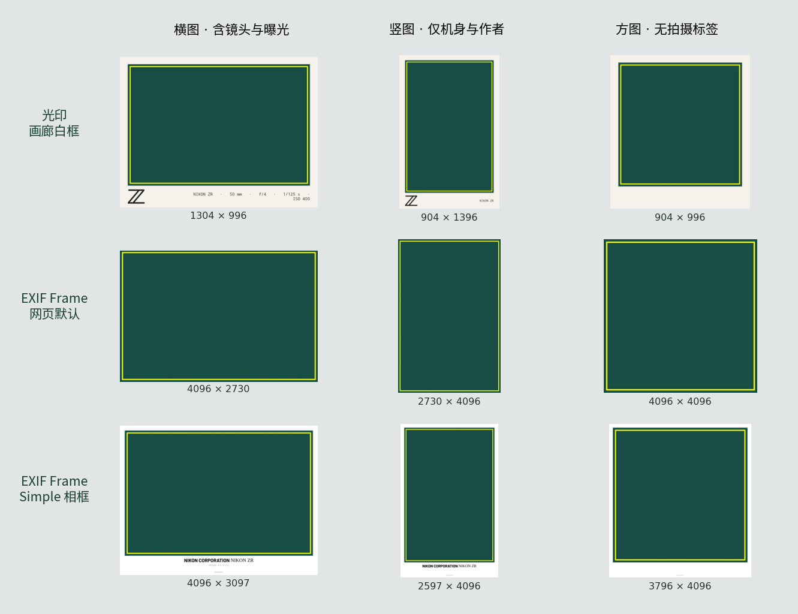

# 光印 0.0.2 开发版的竞品实测与改进顺序

2026 年 11 月 20 日。本次研究关注一组相机照片从传到 Android 到发布的过程。摄影师希望机型、镜头、拍摄地点和署名都排得好看，发出去后仍能查到拍摄参数。本次用相同的合成照片对照了光印和 EXIF Frame 网页版。其他产品依据开发者的商店说明、官方帮助或公开反馈分析。商店说明不能代替对应版本的导出实测。

**建议 0.0.2 优先让用户看懂导出会保留什么，再补照片地点自动读取和机型专属标志匹配。** 分享导入、社交画幅、短边尺寸和批量参数组已经进入开发版。11 月 19 日的调研以 0.0.1 为基准，其中这四项应视为已实现。[首轮调研](光印水印竞品调研.md)

## 同一组三张图，两个产品分别导出

三张 JPEG 都是程序生成的绿底黄框，黄线画在照片内缘，便于看清裁切和加框。横图写入尼康品牌、ZR 型号、镜头、50 mm、f/4、1/125 s、ISO 400 和测试作者。竖图只写品牌、型号和作者。方图不写拍摄标签。

光印使用 Android 14 模拟器上的 picker 调试版，从「打开方式」进入，选默认画廊白框、原尺寸、JPEG、质量 95、sRGB、保留常用拍摄参数。EXIF Frame 使用新的 Chromium 浏览器会话，打开 0.4.102 版网页，添加这三张图后点 Download All。下载后用 Pillow 重开每张图，分别读取像素尺寸、主 EXIF 和 ExifIFD 中的镜头及 ISO。[EXIF Frame 网页版](https://exif-frame.yuru.cam/) · [项目说明](https://github.com/jeonghyeon-net/exif-frame)

| 输入 | 光印默认成片 | EXIF Frame 网页版默认成片 |
| --- | --- | --- |
| 横图 1200 × 800，曝光信息齐全 | JPEG 1304 × 996。读回 ZR、镜头和 ISO 400。未写入 Artist | WebP 4096 × 2730。未读到品牌、型号、镜头、ISO 或 Artist |
| 竖图 800 × 1200，仅机身与作者 | JPEG 904 × 1396。读回 ZR。镜头、ISO 和 Artist 为空 | WebP 2730 × 4096。未读到机身和作者 |
| 方图 800 × 800，无拍摄标签 | JPEG 904 × 996。没有生成机身或曝光数据 | WebP 4096 × 4096。没有生成机身或曝光数据 |

第二轮在 EXIF Frame 选择 Simple 相框，启用 JPEG 和保留 EXIF，仍用 Download All。三张成片按顺序为 4096 × 3097、2597 × 4096、3796 × 4096。横图水印显示机身和曝光参数，但从 ZIP 取出的三张 JPEG 均未发现 EXIF APP1 数据段。这个结果适用于本次网页版批量下载路径，单张下载和移动客户端需分别验证。

**空白本身也影响排版。** 光印在全空方图中正确隐藏了标志和参数，但仍留下较宽的空底边。横图的 ISO 单独换到下一行。EXIF Frame 的导入列表在竖图、方图上显示了多处 `undefined`，默认导出的 WebP 与列表应分别评价。建议把无参数、仅机身、长镜头名、长中文署名列为模板的固定验收图。对自动生成的参数条可提供「空行收起」，用户手工指定的画廊留白则保留。

**署名有两个用途。** 作品上能看见的署名和成片文件里的 Artist 是独立的。上述实测中，原有 Artist 没有随光印的 JPEG 一起导出。目前光印支持手填可见署名，导出的 EXIF 使用拍摄参数白名单。建议预览分别说清两件事，给需要交付的摄影师提供作者和版权字段的选择。[光印元数据读取](../app/src/main/java/app/kai/photomark/PhotoRepository.kt) · [光印导出实现](../app/src/main/java/app/kai/photomark/Exporter.kt)

## 竞品解决了哪些摄影工作

| 产品与证据 | 用户能完成的事 | 光印可以借鉴什么 |
| --- | --- | --- |
| OneLine，一行水印，Android | 开发者列出自动 EXIF、可上传的署名、机身和镜头系列标志、最多 100 张批量导出。Google Play 显示 10 万次以上下载。2026 年 10 月有付费用户反馈 Google 相册看不到导出图的设备信息，开发者回复将改进。 | 拍摄参数、个人署名和厂标已经是同类产品的基础能力。优先让用户在相册详情里也能确认交付结果。评论只反映其当时版本。[Google Play 产品页与双方原文](https://play.google.com/store/apps/details?id=com.chuan.yihang&hl=en) |
| 光影印记，Android | 小米应用商店列有 100 多款模板，并介绍文字、图标和边框自定义。 | 光印已有 12 款模板和当前照片的实时缩略图。先让缩略图跟随已选画幅、标题和署名，再按「照片内、边框、雾面、色卡」筛选。用户可以直接比较同一张图。[小米应用商店](https://app.mi.com/details?id=com.lasfuture.mark) · [光印模板面板](../app/src/main/java/app/kai/photomark/EditorScreen.kt) |
| 华为相机与图库 | 官方帮助展示了从图库改水印、分别开关机型、时间、地点、拍摄参数的步骤，并注明适用机型和后置摄像头照片条件。 | 手机用户熟悉「选样式、勾信息」。保留这个短路径，同时让外接相机、胶片扫描件和跨品牌混合批次也能用。[华为官方帮助](https://consumer.huawei.com/cn/support/content/zh-cn16084400/) |
| Shutternote、EXIFrame，Apple 平台 | 前者列出坐标转地名和读取富士 JPG/HIF 胶片配方。后者提供手动镜头设备档案、富士配方与位置移除。开源项目 semi-utils 也有用户询问能否从 EXIF 提取地址印在图上。 | 批量参数组已经覆盖部分手动镜头场景。适合先做照片地点，再用真实样片验证尼康 Picture Control 和富士胶片模拟。单条公开请求能证明需求存在，不能估算使用频率。[Shutternote](https://apps.apple.com/id/app/shutternote-exif-photo-frame/id6757407209) · [EXIFrame](https://apps.apple.com/us/app/exiframe-photo-exif-frame/id6738852892) · [semi-utils 用户请求](https://github.com/leslievan/semi-utils/issues/109) |
| Reframe、Lightroom Mobile | Reframe 区分保留整张与填满画框，并提供 HDR 编辑、SDR 预览和多种导出方式。Adobe 明确说明 JPEG 的 HDR 通过增益图保存，接收端可能只显示 SDR。 | 把画幅、像素和色调分开说明。P3 是色域，保留 P3 不能证明保留 HDR。对照明确支持 HDR 的移动产品，可以纠正初稿对 Android 侧能力的笼统判断。[Reframe 版本说明](https://apps.apple.com/us/app/reframe-exif-frame/id6483865815) · [Adobe HDR 导出](https://helpx.adobe.com/lightroom/mobile/share-save-and-export/export-hdr-photos.html) |
| Copicseal、semi-utils，开源 | Copicseal 有用户选 100% 画质后发现加框占用了照片本体的像素，维护者解释尺寸设置针对输出画布。semi-utils 的公开 JSON 可查到模板如何组合字段。 | 「原尺寸」旁边同时列出照片本体和最终画布。已有 ZIP 预设可先公开格式、字段示例和样图，让摄影师能验证别人的模板再导入。[Copicseal 讨论](https://github.com/copicseal/copicseal/issues/100) · [semi-utils 模板文件](https://github.com/leslievan/semi-utils/blob/main/static/standard1.json) |

EXIF Frame（开源 Web/Android/iOS）和 EXIFrame（上表的 Apple 应用）是两个项目。OneLine 的下载次数是 Google Play 档位。其他商店的销售量、活跃用户数和不同产品的市场份额，本次没有可比数据。[开源 EXIF Frame](https://github.com/jeonghyeon-net/exif-frame) · [EXIFrame 开发者商店页](https://apps.apple.com/us/app/exiframe-photo-exif-frame/id6738852892)

## 建议排期与验收

| 优先级 | 建议与取舍 | 可验证的完成条件 |
| --- | --- | --- |
| 1 · 导出前看清结果 | 导出面板把「照片本体尺寸 → 成片尺寸」「像素来源」「将写入的字段」放在一起。混合批次汇总有多少张只能用内嵌预览、多少张会转为 SDR。先显示可判定的信息。 | 用 ZR 的 NEF＋JPEG、单独高效率 NEF、HLG HEIF、缺 EXIF 的 JPEG 组成一批。面板数字与实际成片逐项相符。重新读取成片核对机型、镜头、署名、位置策略。原尺寸外扩边框时保留照片本体像素。 |
| 2 · 自动地点与手填兜底 | 读取照片自己的 GPS，默认不把精确坐标印上照片。先提供自选坐标显示和手填地名，再评估离线城市库的安装体积、边界精度和许可。显示地名和在成片文件保留精确 GPS 分别控制。 | 在相册原件、系统选片、外部分享、无坐标、拒绝读取原件五种场景验证。无法拿到原始 GPS 时可直接手填。关闭位置后，画面无地点且默认输出不含 GPS。仅印城市名时，文件中仍无坐标。[Android 原始媒体位置访问](https://developer.android.com/training/data-storage/shared/media) |
| 3 · 精确到机型的标志 | 素材库已有 7 个品牌的 74 款机型标志，目前需手动导入。首批可从尼康 ZR、Z f、Z9，佳能 EOS R5 Mark II，索尼 α7 IV 和富士 X-T5 做起。编辑器保留「品牌、机型、自选」和尼康方标、横标选择。 | 真实 EXIF 别名能匹配正确机身，同系列不同代不串标。没有独立标志时回退品牌标，未知品牌允许手选。跨品牌混合导出逐张匹配，检查黑白与雾面背景下的对比度。[素材目录及来源](../model-marks/README.md) · [品牌标志规则](../docs/brand-marks.md) |
| 4 · 版式与可移植预设 | 统一缩略图与最终水印使用的画幅、有效字段及署名。为缺字段的图提供紧凑排版，为有意留下的空白保留手动选项。公开预设包示例、预览图和字体缺失时的替代规则。 | 用横、竖、方图和中英文长署名切换模板。缩略图与成片一致，单独一项参数能正常对齐。预设在另一台设备导入后使用相同标志与字体。[现有模板](../app/src/main/java/app/kai/photomark/Templates.kt) · [预设归档](../app/src/main/java/app/kai/photomark/PresetArchive.kt) |
| 单独验证 · 厂商色彩与 HDR | 先用真机照片验证 ZR Picture Control 和富士胶片模拟的名称、数据位置和厂商处理差异。HDR 独立做只带外扩边框的 Android Ultra HDR JPEG 样片。HLG HEIF 另测，动态照片另排。 | 拍摄预设名称对照相机设置。字段缺失时隐藏或手填。HDR 成片重新解码能取出增益图，在 HDR 屏和 SDR 屏上检查照片、框边、文字，不能只数文件内的标签。[尼康 ZR 规格](https://imaging.nikon.com/imaging/lineup/z_cinema/z_r/) · [Android 增益图编辑](https://developer.android.com/media/grow/ultra-hdr/edit) |

以 ZR 为例，SnapBridge 可以下载原尺寸，也可能传来 200 万像素的 JPEG 或 HEIF。光印可准确显示收到的文件尺寸和像素来源。只有在确有证据时才应标注传输方式。SnapBridge 也支持按拍摄时间嵌入地点。先把「收到多大」「用哪份像素」「发布时显示哪个地点」交代清楚，对现场传图和旅行组照都有价值。[尼康下载尺寸说明](https://nikonimglib.com/snbr/onlinehelp/en/downloading_selected_pictures_11.html) · [尼康照片位置说明](https://nikonimglib.com/snbr/onlinehelp/en/embedding_location_data_in_pictures_27.html)
